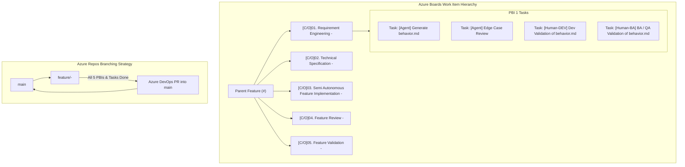

# Azure DevOps (ADO) Agentic SDLC - End-to-End Enterprise Guide

This document establishes the enterprise architecture for running the **Agentic Software Development Lifecycle (ASDLC)** natively on **Azure DevOps (ADO)** via the **Azure CLI (`az devops`, `az boards`, `az repos`)** and dedicated `.azuredevops/` agents.

---

## 1. Enterprise Architecture & Azure Boards Hierarchy

Every software initiative is governed under Azure Boards with a strict parent-child structure and corresponding Git feature branch:



---

## 2. Key Operational Principles

1. **Autonomous Provisioning from Feature ID:**
   - The user only needs to create the **Feature** in Azure Boards and give the agent the **Feature ID**.
   - The agent automatically queries the Feature title, formats the dedicated branch name `feature/<feature ID>-<feature slug>`, and creates the 5 Child PBIs directly on Azure Boards under that Feature.
   - The agent automatically creates granular child **Tasks** under each PBI, partitioned into `[Agent]` and role-prefixed `[Human-*]` tasks.

2. **Clean Codebase: Artifacts vs Source Code:**
   - **`artifacts/<feature-name>/`:** All documentation, specifications (`behavior.md`, `tech-spec.md`, test matrices), and review/validation reports are stored strictly in the `artifacts/` directory.
   - **Application Code:** Actual application code (controllers, models, UI, services) and unit tests remain outside `artifacts/` in standard directories (`src/`, `lib/`, `tests/`).

3. **Role-Prefixed Human Tasks (`[Human-DEV]`, `[Human-QA]`, `[Human-LEAD]`, `[Human-BA]`):**
   - **`[Agent]` Tasks:** The AI agent performs its specific assignment, outputs the deliverable, and updates the task to `Done`.
   - **`[Human-*]` Tasks:** Explicitly tagged by discipline (DEV, QA, LEAD, BA). The agent never touches or marks human tasks as `Done`. If changes are needed, the human reviewer edits locally in their workspace, pushes to the branch, and manually marks the task `Done` on Azure Boards.

4. **Strict Single-Agent Execution:**
   - When an agent is triggered for a specific task, it executes only that task. Agents do not execute other agents' assignments within the same PBI.

---

## 3. ADO Agent & Phase Mapping

| ASDLC Phase & Child PBI | Executing ADO Agent | Quality / Review Agent | Granular Child Tasks | Primary Artifacts (`artifacts/<feature>/`) | Human Review Gate |
| :--- | :--- | :--- | :--- | :--- | :--- |
| **01. Requirement Engineering** | `ado-behavior-generator.agent.md` | `behavior-edge-case-review.agent.md` | • `[Agent] Generate behavior.md`<br/>• `[Agent] Edge Case & Boundary Review`<br/>• `[Human-DEV] Dev Validation of behavior.md`<br/>• `[Human-BA] BA / QA Validation of behavior.md` | `artifacts/<feature>/behavior.md`<br/>`artifacts/<feature>/behavior-edge-case-review-report.md` | **Gate 1:** DEV and BA/QA verify business rules, edit if needed, push changes, and mark human tasks Done. |
| **02. Technical Specification** | `create-tech-spec-md` skill | `devils-advocate.agent.md`<br/>`behavioral-test-case-review.agent.md`<br/>`technical-test-case-review.agent.md` | • `[Agent] Generate tech-spec.md & Test Matrices`<br/>• `[Agent] Devil's Advocate Review`<br/>• `[Human-LEAD] Tech Lead Architecture Review`<br/>• `[Human-QA] QA Lead Test Matrix Sign-off` | `artifacts/<feature>/tech-spec.md`<br/>`artifacts/<feature>/behavioral-test-case.md`<br/>`artifacts/<feature>/technical-test-case.md` | **Gate 2:** Tech Lead and QA Lead approve architecture and mark human tasks Done. |
| **03. Feature Implementation** | `spec-to-code.agent.md` | Compiler / Test Runner (`dotnet test`, `npm test`) | • `[Agent] Implement Source Code & Unit Tests`<br/>• `[Agent] Verify Compilation & Test Execution`<br/>• `[Human-DEV] Dev Local Code & Debug Validation` | Production Code (in `src/`), Unit Tests (in `tests/`) — *outside artifacts* | **Gate 3:** DEV pulls branch, verifies local build/debug, and marks human task Done. |
| **04. Feature Review** | `code-verifier.agent.md`<br/>`self-healing-pr.agent.md` | `pr-review.agent.md` | • `[Agent] Code Verification & Static Audit`<br/>• `[Agent] Generate PR Review Audit Report`<br/>• `[Human-DEV] Peer Engineer Code Review Sign-off` | `artifacts/<feature>/code-verification-report.md`<br/>`artifacts/<feature>/pr-review-report.md` | **Gate 4:** Senior Peer Reviewer audits code diff and marks human task Done. |
| **05. Feature Validation** | `app-launcher.md`<br/>`test-automation-generator.agent.md` | `ui-validator.agent.md`<br/>`test-automation-healer.agent.md` | • `[Agent] E2E Automation Suites & UI Validation`<br/>• `[Agent] Run Self-Healing Validation Loops`<br/>• `[Human-QA] Final QA Acceptance Sign-off` | Playwright suites<br/>`artifacts/<feature>/ui-validation-report.md` | **Gate 5:** QA Sign-off on test execution pass; marks human task Done. |

---

## 4. Azure CLI Operational Playbook

### Step 1: Provisioning PBIs, Tasks, and Branch from Feature ID
Given Feature ID (e.g. `<FEATURE_ID>`):
```powershell
# 1. Inspect Feature
$featureId = "<FEATURE_ID>"
$feat = az boards work-item show --id $featureId --output json | ConvertFrom-Json
$featureTitle = $feat.fields.'System.Title'
$areaPath = $feat.fields.'System.AreaPath'
$iterationPath = $feat.fields.'System.IterationPath'

# 2. Form branch slug
$slug = ($featureTitle.ToLower() -replace '[^a-z0-9]+', '-').Trim('-')
$branchName = "feature/${featureId}-$slug"

# 3. Create dedicated branch
git checkout main
git pull origin main
git checkout -b $branchName
git push -u origin $branchName

# 4. Provision 5 Child PBIs
$pbis = @(
    "[C/O]01. Requirement Engineering - $featureTitle",
    "[C/O]02. Technical Specification - $featureTitle",
    "[C/O]03. Semi Autonomous Feature Implementation - $featureTitle",
    "[C/O]04. Feature Review - $featureTitle",
    "[C/O]05. Feature Validation - $featureTitle"
)

foreach ($title in $pbis) {
    # Create PBI
    $pbi = az boards work-item create --title "$title" --type "Product Backlog Item" --area $areaPath --iteration $iterationPath --output json | ConvertFrom-Json
    
    # Establish Parent-Child Link in Azure Boards
    az boards work-item relation add --id $pbi.id --relation-type "Parent" --target-id 9
    Write-Host "Created Child PBI #$($pbi.id) linked to Feature #9"
}
```

### Step 2: Task Execution & Artifact Seating
When an agent completes a deliverable:
1. Save artifact strictly inside `artifacts/<feature>/`.
2. Commit with the target PBI ID in the commit message:
   ```bash
   git add artifacts/
   git commit -m "feat(spec): The behavior.md for $featureTitle #<PBI_ID>"
   git push origin $branchName
   ```
3. Update the PBI and Task Description with clickable deliverable links.
4. Transition the agent task to `Done`.
5. Leave role-prefixed human tasks (`[Human-DEV]`, `[Human-QA]`, `[Human-LEAD]`, `[Human-BA]`) in `To Do` for human engineers to review locally, make edits if needed, and manually mark `Done`.
