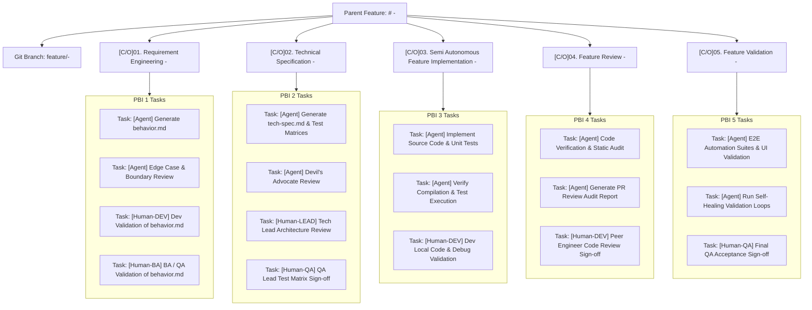

# Azure Boards ASDLC Feature, PBI, and Task Architecture Instructions

This document governs how Azure DevOps AI Agents interact with **Azure Boards** and **Azure Repos** via the Azure CLI (`az boards`, `az repos`). It standardizes automated PBI/Task provisioning, branch creation, storing all specifications and reports inside a dedicated `artifacts/` folder (keeping application source code clean and outside `artifacts/`), role-prefixed human tasks, and mandatory pre-execution checks for pending human tasks.

---

## 1. Complete Azure Boards Hierarchy Standard

When an engineer or business user creates a **Feature** in Azure Boards (e.g. `Feature #<FEATURE_ID>: <Feature Name>`), the user simply gives the Agent the **Feature ID**.

The Agent automatically provisions:
1. Exactly **5 Child Product Backlog Items (PBIs)** under the Feature.
2. The Git branch: `feature/<feature ID>-<feature slug>`.
3. Dedicated **Child Tasks** under each PBI, explicitly partitioned into:
   - **`[Agent]` Tasks**: Executed and marked `Done` autonomously by the designated AI Agent.
   - **Role-Prefixed `[Human-*]` Tasks**: Assigned to specific human disciplines (`[Human-DEV]`, `[Human-QA]`, `[Human-LEAD]`, `[Human-BA]`). Human reviewers inspect/modify files locally, push to the branch, and manually mark the task `Done` on Azure Boards.



---

## 2. Directory Structure: Artifacts vs Source Code

To ensure a clean codebase and avoid mixing documentation/reports with application code:
1. **`artifacts/` Folder (Reports, Specs, Review Audits ONLY):**
   All ASDLC specifications, review reports, and test audit results are saved inside `artifacts/<feature-name>/`:
   ```text
   artifacts/
   └── <feature-name>/
       ├── behavior.md
       ├── behavior-edge-case-review-report.md
       ├── tech-spec.md
       ├── behavioral-test-case.md
       ├── technical-test-case.md
       ├── devils-advocate-review-report.md
       ├── code-verification-report.md
       ├── pr-review-report.md
       └── ui-validation-report.md
   ```
2. **Application Source Code (Normal Codebase Directories, OUTSIDE `artifacts/`):**
   All actual production code (backend, frontend, database scripts) and unit/integration tests remain in normal application folders (`src/`, `lib/`, `tests/`, etc.). **Source code NEVER sits inside `artifacts/`.**

---

## 3. Standard PBI & Role-Prefixed Task Naming Patterns

### Child PBIs (Created by Agent under Feature)
- `[C/O]01. Requirement Engineering - <Feature Name>`
- `[C/O]02. Technical Specification - <Feature Name>`
- `[C/O]03. Semi Autonomous Feature Implementation - <Feature Name>`
- `[C/O]04. Feature Review - <Feature Name>`
- `[C/O]05. Feature Validation - <Feature Name>`

### Standard Granular Tasks under Each PBI
| PBI | Task Title | Owner Discipline | Action Required |
| :--- | :--- | :--- | :--- |
| **01. Requirement Eng.** | `[Agent] Generate behavior.md` | Agent | Parse requirements, output `artifacts/<feature>/behavior.md`, commit with `#<PBI_ID>`, attach link to Task & PBI, set to `Done`. |
| | `[Agent] Edge Case & Boundary Review` | Agent | Run `behavior-edge-case-review.agent.md`, output `artifacts/<feature>/behavior-edge-case-review-report.md`, set to `Done`. |
| | `[Human-DEV] Dev Validation of behavior.md` | Developer | Developer verifies technical feasibility of business rules, edits locally if needed, pushes to branch, marks task `Done`. |
| | `[Human-BA] BA / QA Validation of behavior.md` | Business Analyst / QA | BA / QA validates acceptance criteria match business expectations, marks task `Done`. |
| **02. Tech Spec** | `[Agent] Generate tech-spec.md & Test Matrices` | Agent | Create `tech-spec.md`, `behavioral-test-case.md`, `technical-test-case.md` in `artifacts/<feature>/`, commit with `#<PBI_ID>`, set to `Done`. |
| | `[Agent] Devil's Advocate Review` | Agent | Run `devils-advocate.agent.md`, output challenge report in `artifacts/<feature>/`, set to `Done`. |
| | `[Human-LEAD] Tech Lead Architecture Review` | Tech Lead / Architect | Tech Lead validates architecture, schema, security contracts, marks task `Done`. |
| | `[Human-QA] QA Lead Test Matrix Sign-off` | QA Lead | QA Lead accepts test case matrices, marks task `Done`. |
| **03. Implementation** | `[Agent] Implement Source Code & Unit Tests` | Agent | Run `spec-to-code.agent.md`, generate production code in normal app directories (`src/`), unit tests in `tests/`, commit with `#<PBI_ID>`, set to `Done`. |
| | `[Agent] Verify Compilation & Test Execution` | Agent | Execute local compiler and test runners, verify 100% pass, set to `Done`. |
| | `[Human-DEV] Dev Local Code & Debug Validation` | Developer | Developer pulls branch, runs app locally, modifies code if needed, pushes, marks task `Done`. |
| **04. Feature Review** | `[Agent] Code Verification & Static Audit` | Agent | Run `code-verifier.agent.md` & `self-healing-pr.agent.md`, output audit report in `artifacts/<feature>/`, set to `Done`. |
| | `[Agent] Generate PR Review Audit Report` | Agent | Run `pr-review.agent.md`, output `pr-review-report.md` in `artifacts/<feature>/`, set to `Done`. |
| | `[Human-DEV] Peer Engineer Code Review Sign-off` | Senior Developer | Peer reviewer audits git diff, approves code changes, marks task `Done`. |
| **05. Feature Validation**| `[Agent] E2E Automation Suites & UI Validation`| Agent | Run automation and UI validator, output `ui-validation-report.md` in `artifacts/<feature>/`, set to `Done`. |
| | `[Agent] Run Self-Healing Validation Loops` | Agent | Run `test-automation-healer.agent.md` to ensure zero regressions, set to `Done`. |
| | `[Human-QA] Final QA Acceptance Sign-off` | QA Lead | QA Lead runs smoke test, approves feature completion, marks task `Done`. |

---

## 4. Agent Execution & Stop Behavior

1. **Autonomous Agents Do Only Their Designated Task:**
   - An agent executes only the task assigned to it.
   - It completes any automated review assigned to it (e.g. Edge Case Review or Devil's Advocate Review).
   - It commits with `#<PBI_ID>`, updates the task description, transitions its task to `Done`, and **STOPS**.
2. **Human Review Phase:**
   - The human reviewers perform their work locally or on ADO Repos, push modifications to the branch if needed, and manually set their task to `Done` in Azure Boards.

---

## 5. Pre-Execution Gate: Checking Pending Human Tasks

When an agent is invoked for the next phase (e.g., invoking Phase 2 after Phase 1):
1. **Query Azure Boards:**
   The agent checks all preceding `[Human-*]` tasks:
   ```powershell
   az boards work-item show --id <PREVIOUS_HUMAN_TASK_ID> --output json
   ```
2. **Warn User if Previous Tasks are Incomplete:**
   If any previous `[Human-*]` task is NOT in `Done` state, the agent **MUST** prompt the user using `ask_question`:
   - **Question:** *"⚠️ Previous task(s) on Azure Boards are pending: `<task_name>` (ID: `<task_id>`). Complete it and make it Done, or ignore and move on?"*
   - **Option 1 (Recommended):** *"I will complete the task <task_name> first. Please stop so I can review and mark it Done."*
     - If selected, the agent instructs: *"Please complete the task `<task_name>` in Azure Boards, then re-execute the agent."* ➔ **Agent STOPS immediately.**
   - **Option 2:** *"Ignore pending tasks and proceed with execution."*
     - If selected, the agent continues and executes the next phase normally.

---

## 6. Seating Deliverables Inside PBIs & Tasks (Artifact Attachment)

Every generated artifact MUST seat directly inside its corresponding PBI and Task:
1. **PBI & Task Description Update:**
   The Description field of the PBI and Task must be updated with an HTML deliverable summary and clickable links to the file in Azure Repos under `artifacts/<feature>/`:
   ```powershell
   az boards work-item update --id <PBI_ID> --description "<h3>Phase Deliverables</h3><p><b>Spec:</b> <a href='https://dev.azure.com/<ORG>/<PROJECT>/_git/<REPO>?path=/artifacts/<FEATURE>/behavior.md&version=GBfeature/<BRANCH>'>behavior.md</a></p>"
   ```
2. **Commit Message Reference `#<PBI_ID>`:**
   Every git commit created by an agent MUST reference `#<PBI_ID>`:
   ```bash
   git commit -m "feat(spec): The behavior.md for <feature> #<PBI_ID>"
   ```
   This automatically seats the commit and linked files under the right-side **Development** section in Azure Boards.
