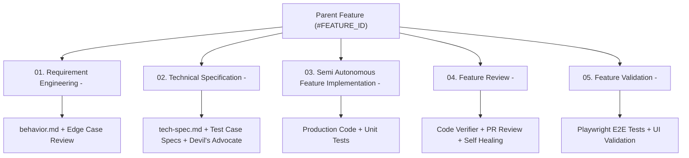

# Skill: Azure Boards Feature Orchestrator (`ado-board-feature-orchestrator`)

## Purpose
This skill coordinates the lifecycle of an Azure Boards Feature work item across all 5 ASDLC phases using Azure CLI (`az boards`, `az repos`) and Git.

---

## 5-PBI Phase Hierarchy Standard



---

## Azure CLI Orchestration Playbook

### 1. Retrieve Feature Details
```powershell
$feature = az boards work-item show --id <FEATURE_ID> --output json | ConvertFrom-Json
$featureTitle = $feature.fields.'System.Title'
```

### 2. Create and Checkout Feature Branch
```powershell
$slug = ($featureTitle.ToLower() -replace '[^a-z0-9]+', '-').Trim('-')
$branchName = "feature/<FEATURE_ID>-$slug"

git checkout main
git pull origin main
git checkout -b $branchName
git push -u origin $branchName
```

### 3. Generate the 5 Child PBIs
```powershell
$pbiTitles = @(
    "[C/O]01. Requirement Engineering - $featureTitle",
    "[C/O]02. Technical Specification - $featureTitle",
    "[C/O]03. Semi Autonomous Feature Implementation - $featureTitle",
    "[C/O]04. Feature Review - $featureTitle",
    "[C/O]05. Feature Validation - $featureTitle"
)

foreach ($title in $pbiTitles) {
    # 1. Create Child PBI
    $pbi = az boards work-item create --title "$title" --type "Product Backlog Item" --output json | ConvertFrom-Json
    
    # 2. Link PBI to Parent Feature
    az boards work-item relation add --id $pbi.id --relation-type "Parent" --target-id <FEATURE_ID>
    
    Write-Host "Created and linked PBI: $($pbi.id) - $title"
}
```

### 4. Transition PBI Status & Log Artifacts
```powershell
# Set PBI to Active
az boards work-item update --id <PBI_ID> --state "Active"

# Post Artifact Completion Comment
az boards work-item update --id <PBI_ID> --discussion "Artifact generated and reviewed. Dual AI & Human approval completed."

# Mark PBI as Done
az boards work-item update --id <PBI_ID> --state "Done"
```

### 5. Final Pull Request & Merge to Main
```powershell
az repos pr create `
    --source-branch "$branchName" `
    --target-branch "main" `
    --title "Feature <FEATURE_ID>: $featureTitle" `
    --work-items <FEATURE_ID> `
    --output table
```
