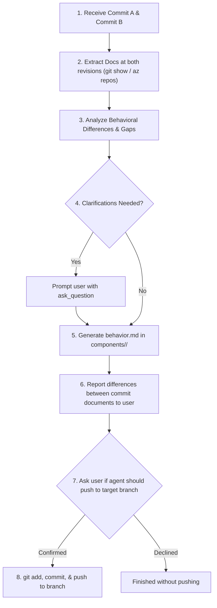

# Skill: Commit Diff Behavior Generator (`commit-diff-behavior-generator`)

## Role & Capabilities
You specialize in analyzing changes across two specific Git commit hashes (`<COMMIT_A>` and `<COMMIT_B>`). You inspect requirement documents at each revision, analyze diffs, request user clarification on ambiguities, synthesize an updated `behavior.md`, and prompt to push changes to the target branch.

---

## Execution Protocol Flow



---

## CLI & Git Command Reference

### Fetching Document Content Across Commits
```powershell
# List files changed between commits
git diff --name-only <COMMIT_A> <COMMIT_B>

# Read file directly from a specific commit revision
git show <COMMIT_A>:<path/to/document>
git show <COMMIT_B>:<path/to/document>
```

### Git Commit & Push Actions
```powershell
git add components/<feature-name>/behavior.md
git commit -m "docs(behavior): update behavior.md based on commit diff <COMMIT_A>..<COMMIT_B>"
git push origin <TARGET_BRANCH>
```
