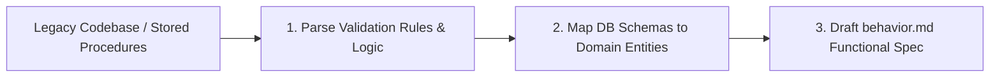

# Legacy Analyzer Skill

This skill equips Phase 1 agents (`@behavior-edge-case-review`) with reverse-engineering workflows to transform legacy C#, WebForms, Java, or stored procedures into clean functional specs.

---

## 1. Reverse Engineering Methodology



---

## 2. Legacy Code Parsing Patterns

### Extracting Rules from SQL Stored Procedures
- Look for `IF ... RAISERROR(...)` blocks -> Convert to Business Rules (`BR-XX`).
- Inspect `CHECK` constraints, foreign keys, and unique indexes -> Convert to Input Validation limits.

### Extracting Rules from C# Controllers
```csharp
// Legacy controller inspection:
if (string.IsNullOrWhiteSpace(model.Title) || model.Title.Length > 50)
{
    // Extract: Rule BR-TRK-01 -> Title required, max 50 characters.
    return BadRequest("Title is required and must be under 50 chars");
}
```
