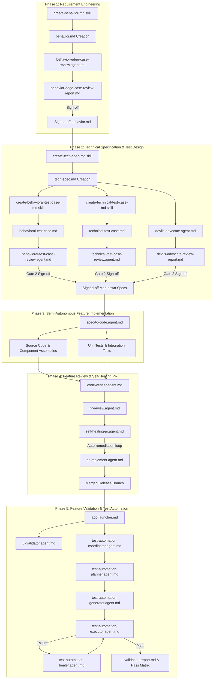

# Agentic Software Development Lifecycle (ASDLC) - End-to-End Operational Manual

The **Agentic Software Development Lifecycle (ASDLC)** is a enterprise-grade, 5-phase software delivery methodology tailored for autonomous execution by GitHub Copilot, custom Copilot Agents, and sub-agent automation pipelines. ASDLC replaces unstructured code generation prompts with an interconnected web of **Agents**, **Prompts**, **Instructions**, and **Skills**, driving feature requests from initial requirements gathering to automated production-ready code, self-healing code reviews, and Playwright TypeScript end-to-end validation.

---

## 1. Complete Architecture & Phase Diagram



---

## 2. Phase-by-Phase Detailed Operational Guide

### Phase 1: Requirement Engineering
- **Purpose:** Transform high-level business ideas, user stories, or legacy systems into an explicit, version-controlled behavioral specification document (`behavior.md`).
- **Human Roles:** Business Analyst (BA), Product Owner (PO), Lead Architect.
- **Agent Roles:** `behavior-edge-case-review.agent.md`
- **Recommended Model:** `GPT-5.6 Sol` (High reasoning) or `Claude Opus 5`.
- **Inputs Required:** Feature request overview, target directory path (e.g. `components/<feature-name>/`).
- **Step-by-Step Execution:**
  1. Open GitHub Copilot Chat in your IDE.
  2. Execute the prompt:
     ```text
     /Create-Behavior-MD feature="components/order-service/"
     [Insert raw feature requirements, user stories, and acceptance criteria here]
     ```
  3. Copilot will read `.github/instructions/behavior-doc.instructions.md` and generate `components/order-service/behavior.md`.
  4. Run the Edge Case Review Agent:
     ```text
     @behavior-edge-case-review analyze behavior.md in "components/order-service/"
     ```
  5. Inspect `behavior-edge-case-review-report.md`. Resolve all critical gaps in `behavior.md` before obtaining BA & Tech Lead sign-off.

---

### Phase 2: Technical Specification & Dual Test Case Design
- **Purpose:** Convert functional requirements (`behavior.md`) into a technical implementation blueprint (`tech-spec.md`) and deterministic test case specifications (`behavioral-test-case.md` and `technical-test-case.md`).
- **Human Roles:** Technical Lead, Software Architect, QA Lead.
- **Agent Roles:** `devils-advocate.agent.md`, `behavioral-test-case-review.agent.md`, `technical-test-case-review.agent.md`.
- **Recommended Model:** `GPT-5.6 Sol` (Thinking set to Medium).
- **Step-by-Step Execution:**
  1. **Generate Tech Spec:**
     ```text
     /Create-Tech-Spec-MD feature="components/order-service/behavior.md"
     ```
     Generates `components/order-service/tech-spec.md` following `.github/instructions/tech-spec-doc.instructions.md` and architectural skills.
  2. **Run Devil's Advocate Challenge:**
     ```text
     @devils-advocate challenge components/order-service/tech-spec.md
     ```
     Produces `devils-advocate-review-report.md`. Check for scalability bottlenecks, race conditions, and single points of failure.
  3. **Generate Dual Test Specs:**
     ```text
     /Create-Behavioral-Test-Case-MD feature="components/order-service/behavior.md"
     /Create-Technical-Test-Case-MD feature="components/order-service/tech-spec.md"
     ```
  4. **Run Test Spec Auditors:**
     ```text
     @behavioral-test-case-review audit components/order-service/behavioral-test-case.md
     @technical-test-case-review audit components/order-service/technical-test-case.md
     ```
  5. Gain Gate 2 approval across BA, Tech Lead, and QA Lead.

---

### Phase 3: Semi-Autonomous Feature Implementation
- **Purpose:** Automatically generate feature source code, database DDLs, API endpoints, UI components, and unit test suites directly from the signed-off markdown specifications.
- **Human Roles:** Software Developer / Peer Reviewer.
- **Agent Roles:** `spec-to-code.agent.md`
- **Skills Consumed:**
  - `.github/skills/dotnet-microservice-guidelines/SKILL.md`
  - `.github/skills/configurable-variables-guidelines/SKILL.md`
  - `.github/skills/ui-design-guidelines/SKILL.md`
- **Step-by-Step Execution:**
  1. Trigger implementation:
     ```text
     @spec-to-code build feature from components/order-service/tech-spec.md
     ```
  2. The agent reads the micro-task breakdown in `tech-spec.md` and builds code iteratively inside `components/order-service/`.
  3. The agent executes local build commands (`dotnet build`, `npm run build`) and unit tests (`dotnet test`, `npm test`) to guarantee zero compilation errors and 100% test pass rate.

---

### Phase 4: Feature Review & Self-Healing PR
- **Purpose:** Perform static code verification, architectural compliance auditing, automated PR code reviews, and self-healing bug/test remediation.
- **Human Roles:** Code Reviewer, Release Manager.
- **Agent Roles:** `code-verifier.agent.md`, `pr-review.agent.md`, `self-healing-pr.agent.md`, `pr-implement.agent.md`.
- **Step-by-Step Execution:**
  1. **Code Verification:**
     ```text
     @code-verifier verify components/order-service/
     ```
     Generates `code-verification-report.md`.
  2. **PR Code Review:**
     ```text
     @pr-review evaluate PR branch against tech-spec.md
     ```
     Generates `pr-review-report.md`.
  3. **Self-Healing Loop:**
     ```text
     @self-healing-pr inspect and fix active build errors and PR comments
     ```
     The self-healing agent diagnoses root causes, applies targeted code edits, verifies unit tests pass, and commits the healed code to Git.

---

### Phase 5: Feature Validation & Test Automation
- **Purpose:** Launch local/staging environments, perform functional UI validation, and generate/execute/heal Playwright TypeScript E2E test suites.
- **Human Roles:** QA Automation Engineer, Release Lead.
- **Agent Roles:** `app-launcher.md`, `ui-validator.agent.md`, `test-automation-coordinator.agent.md`, `test-automation-planner.agent.md`, `test-automation-generator.agent.md`, `test-automation-executor.agent.md`, `test-automation-healer.agent.md`.
- **Step-by-Step Execution:**
  1. **Launch Environment:**
     ```text
     @app-launcher start environment for components/order-service/
     ```
     Executes `.github/skills/test-automation/startup-stability-preflight/SKILL.md` and verifies application health on HTTP endpoints.
  2. **UI Validation:**
     ```text
     @ui-validator validate deployed app at http://localhost:3000 against behavioral-test-case.md
     ```
     Produces `ui-validation-report.md`.
  3. **Master E2E Test Automation Pipeline:**
     ```text
     @test-automation-coordinator run full end-to-end automation suite for components/order-service/
     ```
     - **Planner:** Generates `e2e-test-plan.md`.
     - **Generator:** Produces Playwright TypeScript scripts under `e2e/tests/` and Page Objects under `e2e/pages/`.
     - **Executor:** Runs `npx playwright test` and logs execution artifacts.
     - **Healer:** Auto-heals broken locators or timing issues, updates Page Object Models, and re-executes tests.

---

## 3. Artifact & Deliverable Matrix

| Phase | Artifact / Deliverable File | Primary Generating Prompt/Agent | Key Validation Gate |
|-------|-----------------------------|---------------------------------|---------------------|
| Phase 1 | `behavior.md` | `/Create-Behavior-MD` | BA & PO Sign-off |
| Phase 1 | `behavior-edge-case-review-report.md` | `@behavior-edge-case-review` | Zero Critical Gaps |
| Phase 2 | `tech-spec.md` | `/Create-Tech-Spec-MD` | Tech Lead Sign-off |
| Phase 2 | `devils-advocate-review-report.md` | `@devils-advocate` | Architecture Risk Mitigation |
| Phase 2 | `behavioral-test-case.md` | `/Create-Behavioral-Test-Case-MD` | QA Lead Sign-off |
| Phase 2 | `technical-test-case.md` | `/Create-Technical-Test-Case-MD` | QA Lead Sign-off |
| Phase 3 | Source Code & Unit Tests | `@spec-to-code` | 100% Unit Test Pass Rate |
| Phase 4 | `code-verification-report.md` | `@code-verifier` | Clean Static Analysis |
| Phase 4 | `pr-review-report.md` | `@pr-review` | Peer Code Review Passed |
| Phase 5 | `ui-validation-report.md` | `@ui-validator` | Functional UI Pass |
| Phase 5 | Playwright E2E Test Suite | `@test-automation-coordinator` | 100% E2E Pass & Auto-Healed Locators |
