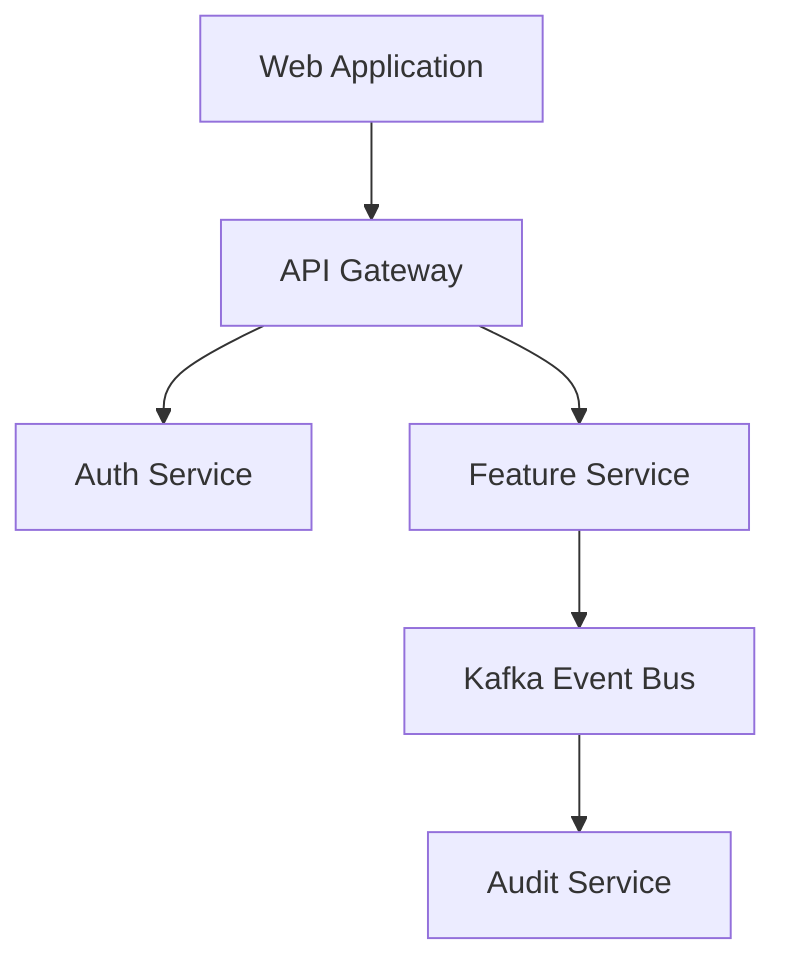

# Overall Behavior Document Instructions

These instructions govern how feature-level `behavior.md` documents across microservices and domain components are synthesized into an overall system behavioral specification.

---

## 1. System Integration Principles

1. **Cross-Feature Traceability:** Track dependencies between domain services (e.g. `OrderService` -> `PaymentService` -> `NotificationService`).
2. **Global Enterprise Policies:** Enforce global cross-cutting policies including OAuth2/OIDC authentication, role-based access control (RBAC), audit logging standards, and data retention rules.
3. **System State Machine Consistency:** Maintain high-level state machine specs governing cross-component workflow lifecycles.

---

## 2. Standard Structure

```markdown
# Overall System Behavior & Integration Architecture Specification

## 1. Multi-Service Architecture Overview
High-level description of microservices, event streams, and UI applications.



## 2. Cross-Cutting Enterprise Policies
- **Security:** Bearer JWT authorization required for all endpoints.
- **Audit Logging:** Every state mutation must publish an audit event containing `UserId`, `Timestamp`, `Action`, and `CorrelationId`.
- **Error Handling Standards:** All APIs must respond with RFC 7807 ProblemDetails payload on error.

## 3. End-to-End User Journeys
Detailed multi-step user scenarios spanning across distinct feature modules.

## 4. Feature Spec Registry
| Feature Module | Relative Directory Path | Core Owner | Dependent Specs |
|----------------|-------------------------|------------|-----------------|
| Order Service | `components/order-service/` | Order Team | `behavior.md`, `tech-spec.md` |
```
