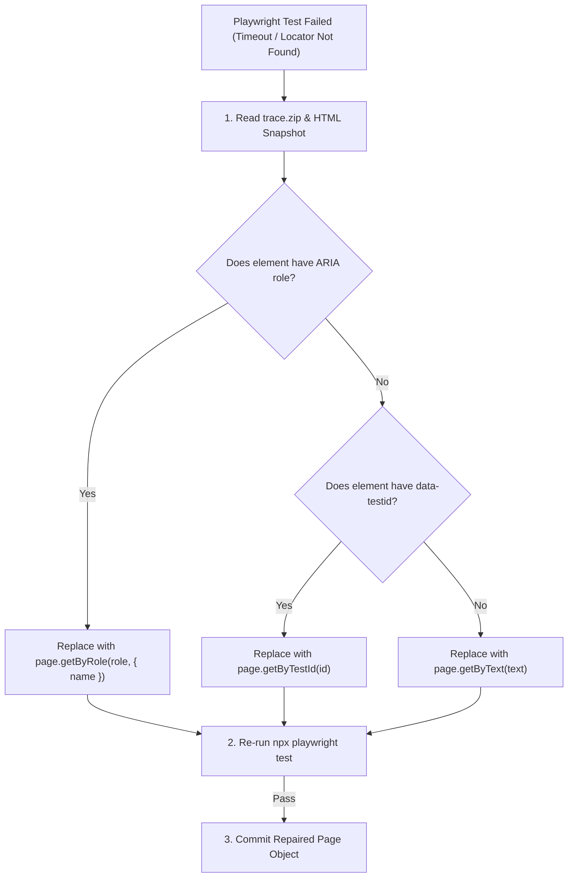

# Test Automation Healing Skill

Equips `@test-automation-healer` to inspect failing Playwright trace logs and auto-repair broken selectors.

---

## 1. Selector Auto-Healing Decision Matrix



---

## 2. Auto-Healing Audit Log Entry Format

When a selector is healed, append an audit entry to `e2e/healing-audit.log`:

```text
[2026-10-07T21:30:00Z] HEALED: components/task-tracker/e2e/pages/task-tracker.page.ts
- Old Locator: page.locator('button#btn-submit-task-v1')
- New Locator: page.getByRole('button', { name: 'Add Task' })
- Failure Cause: Button ID changed from #btn-submit-task-v1 to #btn-submit-task-v2
- Verification: Re-test passed in 1,240ms.
```
