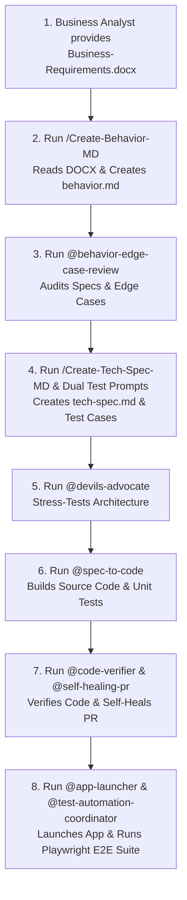

# Developer & Tester Playbook: Simple Task Tracker Project

This playbook demonstrates how a developer or QA tester uses GitHub Copilot and the ASDLC Agents to take a simple, practical Business Analyst Word document (**`Business-Requirements.docx`**) and execute the full end-to-end development, code review, and Playwright automation workflow step-by-step.

---

## 📁 Project Target File Location
- **Input Business Analyst Document:** `components/task-tracker/Business-Requirements.docx`

---

## 🚀 Step-by-Step Agent Execution Sequence



---

## 📝 Commands to Run (One by One)

### Phase 1: Requirements & Edge-Case Review
```text
/Create-Behavior-MD feature="components/task-tracker/" doc_path="components/task-tracker/Business-Requirements.docx"
@behavior-edge-case-review analyze components/task-tracker/behavior.md
```

### Phase 2: Technical Specs & Dual Test Design
```text
/Create-Tech-Spec-MD feature="components/task-tracker/behavior.md"
@devils-advocate challenge components/task-tracker/tech-spec.md
/Create-Behavioral-Test-Case-MD feature="components/task-tracker/behavior.md"
/Create-Technical-Test-Case-MD feature="components/task-tracker/tech-spec.md"
```

### Phase 3: Build Source Code & Unit Tests
```text
@spec-to-code build feature from components/task-tracker/tech-spec.md
```

### Phase 4: Code Review & Self-Healing
```text
@code-verifier verify components/task-tracker/
@self-healing-pr inspect and fix any build errors or PR comments
```

### Phase 5: App Launch & Playwright E2E Testing
```text
@app-launcher start environment for components/task-tracker/
@test-automation-coordinator run full end-to-end automation suite for components/task-tracker/ in live headed mode (--headed)
```

