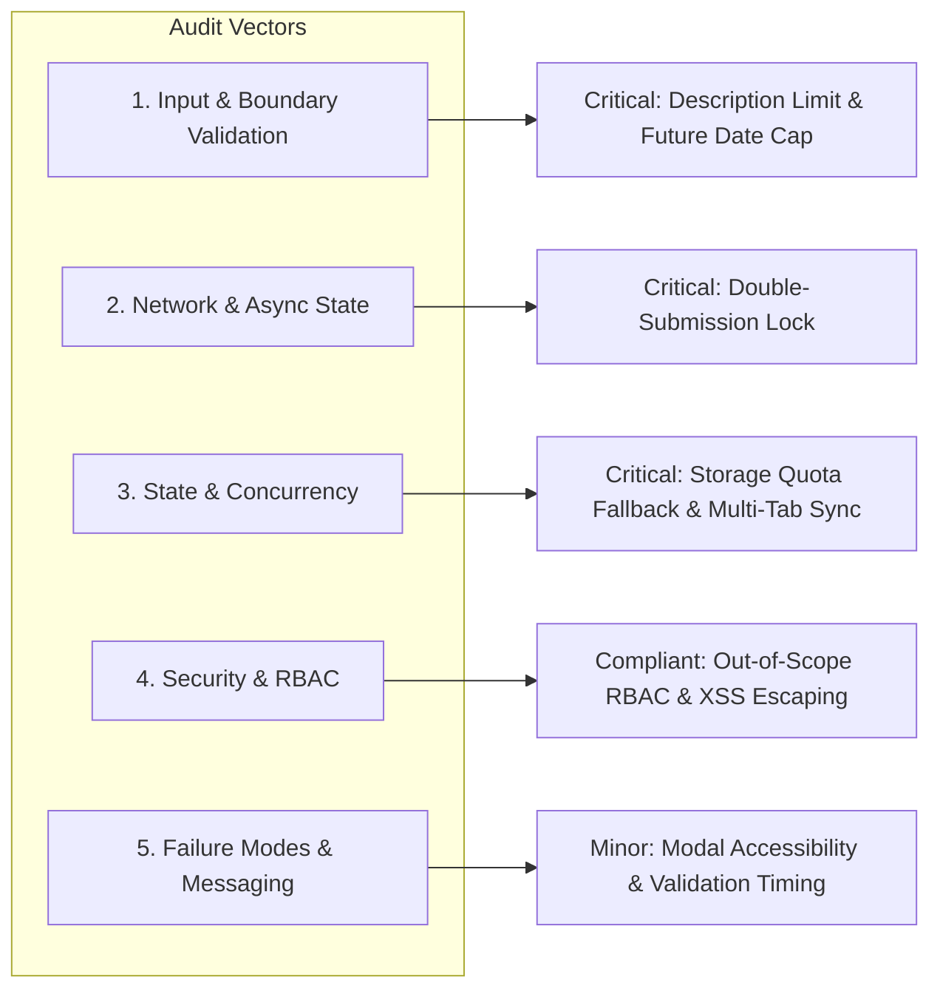

# Behavior Edge Case Review Report: Simple Task Tracker Application

**Target Component:** `components/task-tracker/`  
**Target Specification:** `components/task-tracker/behavior.md`  
**Reviewing Agent:** Behavior Edge Case Reviewer Agent  
**Review Date:** October 7, 2026  
**Status:** Audit Completed - Action Required Prior to Phase 2 Technical Architecture  

---

## Executive Summary

The **Behavior Edge Case Reviewer Agent** has conducted a comprehensive Phase 1 audit of `components/task-tracker/behavior.md`. The primary goal of this review is to validate the specification against 5 key edge-case vectors (Input & Validation Boundaries, Network & Async State, State & Concurrency, Security & Authorization, and Error Handling & User Messaging) to eliminate hidden assumptions before Phase 2 technical architecture design begins.

While the existing `behavior.md` provides a solid functional baseline with well-defined core business rules (`BR-01` to `BR-07`) and basic UI states, several critical boundary condition gaps and persistence edge cases were identified.

---

## Summary of Findings

| Severity | Count | Primary Impact Areas |
| :--- | :---: | :--- |
| 🔴 **Critical Gaps** | **4** | Description length boundaries, unbounded future due dates, local storage quota failures, rapid click double-submission. |
| 🟡 **Minor Gaps** | **4** | Modal keyboard accessibility/backdrop controls, validation trigger timing, search query special characters, multi-tab state sync. |
| 🟢 **Verified Compliant** | **6** | Title whitespace trimming, title length cap (50 chars), status toggling, delete confirmation modal flow, empty state UI triggers, basic XSS escaping. |

---

## 🔴 Critical Gaps (Must Resolve Before Phase 2)

### 1. Missing Description Field Boundary & Length Constraints
- **Vector:** Input & Validation Boundaries
- **Referenced Requirement:** `BR-02`
- **Issue:** `BR-02` specifies that `Description` is optional, but sets no maximum character length limit, no line break constraints, and no text wrapping rules.
- **Risk:** Unbounded descriptions could cause layout overflow, memory bloat in local storage, or visual performance degradation when rendering long task cards.
- **Required Resolution:** Update `BR-02` and `BR-06` to enforce a maximum character limit for `Description` (e.g., max 500 characters) with client-side character count helper text and automatic line-truncation in list view cards.

### 2. Unbounded Future Due Date Boundary & Date Parsing Ambiguities
- **Vector:** Input & Validation Boundaries
- **Referenced Requirement:** `BR-07`, `EC-03`
- **Issue:** `BR-07` restricts due dates to no more than 365 days in the past, but specifies **no upper boundary limit** for future dates (e.g., selecting year 9999 or invalid calendar inputs). Additionally, timezone behavior (client system timezone vs. UTC ISO format) is unspecified.
- **Risk:** Data corruption, improper sorting, or integer/date overflow exceptions in date calculation scripts.
- **Required Resolution:** Expand `BR-07` to cap future due dates at a maximum of 5 years (1,825 days) from the current date. Mandate standard `YYYY-MM-DD` client ISO date formatting.

### 3. Storage Quota Exceeded & Storage Disabled Failure Modes
- **Vector:** State & Concurrency / Failure Modes
- **Referenced Requirement:** `Section 6 (Assumptions & System Dependencies)`
- **Issue:** `behavior.md` assumes client-side local persistence, but does not define behavior if browser `localStorage` is disabled (e.g., strict incognito/private mode settings) or if storage quota is exceeded (`QuotaExceededError`).
- **Risk:** Silent data loss upon page refresh, unhandled JavaScript execution exceptions, and degraded user experience.
- **Required Resolution:** Add a dedicated Business Rule (`BR-08: Local Persistence & Storage Fallback`) specifying that upon startup, the system tests storage availability. If `localStorage` is unavailable or throws a quota exception, display a global notification: *"Local storage unavailable. Tasks will only persist during the current browser session."*

### 4. Form Double-Submission & Rapid Click Race Conditions
- **Vector:** Network & Async State / Concurrency
- **Referenced Requirement:** `BR-02`, `Section 5 (Loading State)`
- **Issue:** No explicit behavioral constraint prevents users from rapidly clicking the "Add Task" button multiple times before client state updates.
- **Risk:** Creation of duplicate task entries with identical titles and timestamps.
- **Required Resolution:** Add requirement specifying that the "Add Task" submission button MUST be immediately disabled upon click and re-enabled only after successful state append and form reset.

---

## 🟡 Minor Gaps & Clarifications

### 1. Delete Modal Keyboard & Backdrop Accessibility
- **Vector:** Error Handling & User Messaging
- **Referenced Requirement:** `BR-05`, `EC-06`
- **Issue:** `EC-06` specifies modal cancellation, but doesn't define keyboard controls (e.g., pressing `Escape` key to close modal, pressing `Enter` to confirm) or backdrop overlay click behavior.
- **Required Resolution:** Document modal UX rules: `Escape` key and backdrop click trigger `Cancel`; keyboard focus is trapped inside the modal while open.

### 2. Inline Validation Trigger Timing
- **Vector:** Input & Validation Boundaries / UX
- **Referenced Requirement:** `Section 5 (Error State)`
- **Issue:** Unclear whether inline validation messages appear on keypress (`onInput`), on blur (`onBlur`), or strictly on form submission (`onSubmit`).
- **Required Resolution:** Clarify that validation messages display on form submission (`onSubmit`), and clear dynamically on input edit (`onInput`).

### 3. Search Query Special Characters & Leading Whitespace
- **Vector:** Input & Validation Boundaries
- **Referenced Requirement:** `BR-04`, `EC-05`
- **Issue:** Behaviour for search strings containing regex special characters (`[`, `*`, `?`, `\`) or whitespace-only queries is unstated.
- **Required Resolution:** Require regex character escaping in the client search filter and specify that leading/trailing search whitespace is trimmed automatically without modifying the visible query field.

### 4. Multi-Tab Synchronized State Behavior
- **Vector:** State & Concurrency
- **Referenced Requirement:** `Section 6`
- **Issue:** Behavior is undefined if the user opens the application in multiple browser tabs simultaneously and mutates tasks.
- **Required Resolution:** Specify whether the application listens to window `storage` events to synchronize state across active tabs in real time or requires manual page refresh.

---

## 🟢 Verified Compliant Requirements

- **BR-01 (Task List Display):** Fully specifies required fields (Title, Priority, Due Date, Status) and default sorting behavior (newest first).
- **BR-03 (Status Toggle):** Clear state transition logic between `Pending` and `Completed` with visual strikethrough requirement.
- **BR-04 / EC-04 / EC-05 (Filtering & Search):** Clear status filter options (`All`, `Pending`, `Completed`), case-insensitive title search, and dedicated Empty State UI handling.
- **BR-05 / EC-06 (Task Deletion):** Mandatory explicit modal confirmation step preventing accidental data loss.
- **BR-06 / EC-01 / EC-02 (Title Validation):** Complete non-empty title enforcement, space-only title rejection, and hard 50-character limit via HTML attributes.
- **EC-07 (Security & Sanitization):** Clear directive for client-side HTML sanitization and string escaping to block XSS vulnerabilities.

---

## Audit Vector Detailed Breakdown

---

## Recommended Action Plan for `behavior.md` Update

1. **Incorporate `BR-08` (Persistence & Quota Handling):** Define clear fallback when browser storage fails.
2. **Refine `BR-02` & `BR-06` (Input Bounds):** Add max 500 characters for `Description`.
3. **Refine `BR-07` (Due Date Bounds):** Add max 5-year future cap and specify `YYYY-MM-DD` timezone format.
4. **Refine `Section 5` & `BR-05` (UI & UX Interactions):** Add submission button debouncing and modal keyboard accessibility rules.

---
*Report generated by Behavior Edge Case Reviewer Agent.*
