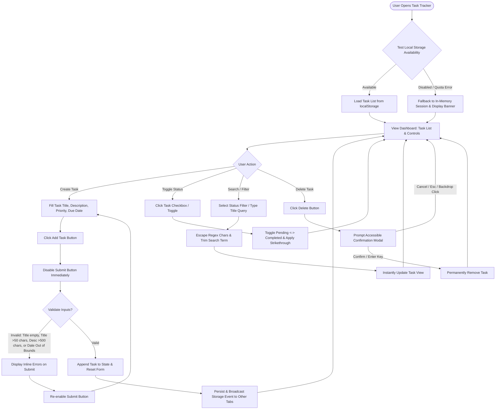

# Functional Specification: Simple Task Tracker Application

## 1. Executive Summary & Business Purpose

The **Simple Task Tracker Application** is a lightweight, web-based productivity component designed to enable team members and employees to manage daily tasks efficiently without the complexity of heavy enterprise project management platforms. 

The primary business objective is to streamline personal task organization by providing an intuitive, single-screen dashboard where users can create tasks, assign priorities and due dates, track task completion states, search and filter active or finished items, and permanently delete completed or obsolete entries.

Key outcomes of this feature include:
- Reduced operational overhead and time spent on manual task tracking.
- Improved visibility into daily action items, priorities, and deadlines.
- Clean, responsive user experience with real-time client-side search and filtering.
- Resilient client-side persistence with fallback session state management.

---

## 2. Feature Scope & Boundaries (In-Scope vs Out-of-Scope Capabilities)

### In-Scope Capabilities
- **Task Visualization:** Displaying a list of tasks with Title, Priority level, Due Date, and Completion Status.
- **Task Creation:** Adding a task with a mandatory Title (max 50 chars), optional Description (max 500 chars), Priority selector (defaulting to Medium), and Due Date.
- **Status Toggling:** Switching a task's status between `Pending` and `Completed` with visual feedback (strikethrough styling).
- **Real-Time Filtering & Search:** Filtering task lists by status (`All`, `Pending`, `Completed`) and text matching on task titles with automatic regex escaping and whitespace trimming.
- **Task Deletion:** Removing individual tasks from the list following explicit user confirmation via an accessible modal.
- **Validation Engine:** Client-side validation ensuring title presence, length caps (Title max 50 chars, Description max 500 chars), double-submission locks, and due date boundary constraints (-1 year to +5 years).
- **Resilient Persistence & Multi-Tab Sync:** Local storage persistence with graceful quota/disabled fallback to session memory, and real-time state synchronization across open browser tabs via `storage` events.

### Out-of-Scope Capabilities
- **Multi-User Collaboration & Authentication:** User login, multi-tenant role-based access control (RBAC), and team task assignment.
- **Recurring Tasks & Calendar Integration:** Setting up daily/weekly recurring tasks or synchronizing with external calendar services (e.g., Google Calendar, Outlook).
- **Sub-tasks & Attachments:** Multi-level nested sub-task trees, file uploads, or document attachments.
- **Automated Notifications & Reminders:** Push notifications, SMS, or email alerts for upcoming or overdue tasks.

---

## 3. As-Is vs To-Be Workflows

### As-Is Workflow
Currently, employees manage daily tasks through unstandardized methods such as local text files, physical sticky notes, or ad-hoc spreadsheet logs. This results in missing due date visibility, lack of status tracking, and difficulty searching or filtering past tasks.

### To-Be Workflow
The To-Be workflow introduces a centralized, reactive Task Tracker interface where task creation, status toggling, search, filtering, and deletion occur seamlessly in real time with client-side validation, submit button debouncing, accessible modal confirmations, and tab synchronization.

---

## 4. Detailed Business Rules & Requirements Matrix

| Business Rule ID | BRD Requirement Ref | Requirement Description | Validation / Constraints | Priority |
| :--- | :--- | :--- | :--- | :--- |
| **BR-01** | `TRK-01` | **Task List View:** The system shall display a structured list of all task items. Each task card or row must show the Title, Priority (`Low`, `Medium`, `High`), Due Date, and Status (`Pending` or `Completed`). | Default sort order by creation date (newest first). Long descriptions in cards must truncate with line-clamp ellipsis. | High |
| **BR-02** | `TRK-02` | **Add Task Form & Anti-Double Submission:** The system shall provide an input form allowing users to create new tasks with Title, Description (optional), Priority dropdown, and Due Date. The "Add Task" button MUST be immediately disabled upon click until submission/validation finishes. | Title is required (max 50 chars). Description is optional (max 500 chars with `0/500` live counter). Priority defaults to `Medium`. Submission lock prevents duplicate creation. | High |
| **BR-03** | `TRK-03` | **Status Toggle:** The system shall allow users to toggle task status between `Pending` and `Completed` via a checkbox or toggle button. | Completed tasks must visually display a strikethrough effect across the title. | High |
| **BR-04** | `TRK-04` | **Filter & Safe Real-Time Search:** The system shall allow users to filter tasks by status tabs (`All`, `Pending`, `Completed`) and search tasks by title via a search input field. | Search filters dynamically as user types (case-insensitive). Regex special characters (`[`, `*`, `?`, `\`, etc.) are auto-escaped. Leading/trailing search whitespace is trimmed without mutating input UI. | Medium |
| **BR-05** | `TRK-05` | **Accessible Task Deletion Modal:** The system shall allow users to permanently delete a task entry after prompting for explicit confirmation in an accessible modal dialog. | Keyboard focus is trapped inside modal while open. `Escape` key or backdrop overlay click triggers `Cancel`. `Enter` key triggers `Confirm`. | Medium |
| **BR-06** | `Validation Rules` | **Input Length & Validation Timing:** Task Title must not be blank/whitespace-only and max 50 chars. Description max 500 chars. Validation messages appear on form submit (`onSubmit`) and clear dynamically on input edit (`onInput`). | Trim title leading/trailing whitespace. Display inline red error text below failing input fields. | High |
| **BR-07** | `Validation Rules` | **Due Date Boundary & Formatting:** Due Date must be formatted in ISO `YYYY-MM-DD` client date format. Due Date cannot be more than 1 year (365 days) in the past nor more than 5 years (1,825 days) in the future from current client date. | Block submission and highlight the Due Date input field with explicit date out-of-range helper text. | High |
| **BR-08** | `Persistence Rules` | **Local Persistence & Storage Fallback:** On application load, the system tests `localStorage` availability. If storage is disabled, unavailable, or throws `QuotaExceededError`, the system falls back to in-memory session state and displays a persistent warning banner. | Banner message: *"Local storage unavailable. Tasks will only persist during the current browser session."* | High |

---

## 5. UI / UX Screen States

### 1. Default State
- Top header with application title ("Simple Task Tracker") and summary stats (e.g. Total Tasks, Pending Count, Completed Count).
- Filter bar containing:
  - Search input box with placeholder "Search tasks by title..."
  - Filter toggle buttons: `All`, `Pending`, `Completed` (default selected: `All`).
- Task Creation panel (collapsible or persistent form at top/side) displaying input fields:
  - Title input with live `0/50` character helper.
  - Description textarea with live `0/500` character helper.
  - Priority dropdown (`Low`, `Medium`, `High`; default `Medium`).
  - Due Date picker (`YYYY-MM-DD`).
- Task List area displaying active task items formatted as cards or table rows.

### 2. Loading & Submission Lock State
- Displays skeleton loader cards or a centered spinner indicator while task items are being fetched or initialized from local storage.
- Add Task submission button displays a disabled state with a loading spinner immediately upon click to prevent rapid double-submission.

### 3. Empty State
- When no tasks exist in the system or no tasks match the current search/filter criteria:
  - Displays a clean visual graphic or icon.
  - Shows helpful text: "No tasks found. Create a new task above or clear your filters."

### 4. Success State
- Upon successful task creation: Form resets to defaults (Priority: `Medium`, clear inputs), submit button is re-enabled, and a temporary toast confirmation appears ("Task created successfully").
- Upon status toggle: Instant UI state update with smooth animation and strikethrough styling for completed tasks.
- Upon deletion confirmation: Item animates out of the list view.

### 5. Error State & Validation Timing
- **Inline Form Validation Errors:** Displayed on form submission (`onSubmit`). Red outline and helper text appear under invalid fields (e.g., Title empty, Title > 50 chars, Description > 500 chars, Date out of -1 yr to +5 yr bounds). Inline errors clear dynamically as the user edits the input (`onInput`).
- **Storage Warning Banner:** Displayed persistently at top of dashboard if `localStorage` is disabled or full.

---

## 6. Assumptions & System Dependencies

### Key Assumptions
1. **Single-User Session & Storage Scope:** The initial implementation operates in a single-user browser session with client-side `localStorage` persistence and fallback in-memory state.
2. **Browser Date & Time:** Due date calculations (-1 year past to +5 years future) rely on standard client system date in ISO `YYYY-MM-DD` format.
3. **Multi-Tab Synchronization:** The application attaches a listener to window `storage` events. When tasks are added, updated, or deleted in one tab, open tabs automatically refresh their task list view in real time.
4. **Responsive Web Display:** The component is designed for modern browsers (Chrome, Edge, Firefox, Safari) across desktop and tablet screen sizes.

### System Dependencies
- Modern Web Runtime (HTML5, Vanilla CSS / modern UI component styling, JavaScript ES2022+).
- Web Storage API (`window.localStorage` and `window.addEventListener('storage', ...)`).
- DOM Event Listener APIs for real-time title search input filtering and modal accessibility keyboard traps.

---

## 7. Edge Cases & Exception Scenarios

| Scenario ID | Edge Case Description | Expected System Behavior | Business Rule |
| :--- | :--- | :--- | :--- |
| **EC-01** | User submits task title containing only spaces (e.g., `"   "`). | System trims whitespace, treats field as empty, blocks submission, and displays inline error: `"Task title cannot be blank."` | `BR-06` |
| **EC-02** | User attempts to type or paste text exceeding character limits (Title > 50 chars, Description > 500 chars). | `maxlength` attributes prevent extra typing; paste operations truncate to allowed limits with helper text indicating max character cap. | `BR-02`, `BR-06` |
| **EC-03** | User enters a due date dated > 365 days in the past or > 1,825 days (5 years) in the future. | Validation rule triggers on form submit (`onSubmit`); date field is highlighted in red with error: `"Due date must be between 1 year in the past and 5 years in the future."` | `BR-07` |
| **EC-04** | User selects a status filter (e.g. `Completed`) when no completed tasks exist. | Task list displays Empty State UI indicating `"No completed tasks found."` | `BR-04` |
| **EC-05** | User enters a search query containing regex special characters (e.g. `[test]*?`) or leading/trailing spaces. | Search term is regex-escaped and leading/trailing whitespace is trimmed before filtering task titles; visible query field text remains untouched. | `BR-04` |
| **EC-06** | User opens Delete Task modal and presses `Escape`, clicks backdrop overlay, or presses `Enter`. | `Escape` key or backdrop click triggers `Cancel` (modal closes, task retained). `Enter` key triggers `Confirm` (task permanently deleted). Focus is trapped inside modal while open. | `BR-05` |
| **EC-07** | Task title or description contains special HTML formatting or script tags. | Inputs are safely sanitized and escaped before rendering in the DOM to prevent XSS. | `BR-02`, `BR-06` |
| **EC-08** | User rapidly clicks "Add Task" button multiple times in quick succession. | Submission button is disabled instantly on first click until state append and form reset finish, preventing duplicate task creation. | `BR-02` |
| **EC-09** | Browser `localStorage` is disabled (incognito mode) or throws `QuotaExceededError`. | System catches exception, falls back to in-memory session array, and displays top warning banner: `"Local storage unavailable. Tasks will only persist during current session."` | `BR-08` |
| **EC-10** | Tasks are created, modified, or deleted in another active browser tab. | Window `storage` event fires and automatically syncs task list state across all open tabs. | `Section 6` |
