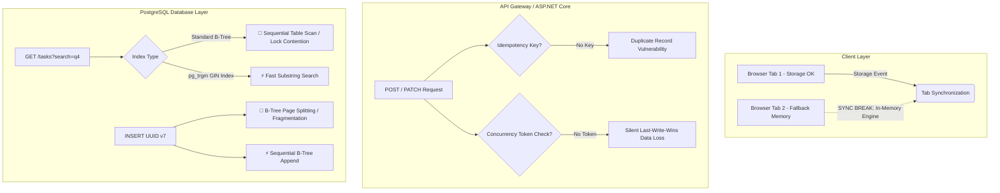

# Devil's Advocate Architecture Review Report: Simple Task Tracker

**Target Component:** `components/task-tracker/`  
**Target Technical Specification:** `components/task-tracker/tech-spec.md`  
**Reviewing Agent:** Devil's Advocate Agent (`devils-advocate.agent.md`)  
**Review Date:** October 7, 2026  
**Status:** Audit Completed — Architectural Risks & Mandatory Mitigations Identified  

---

## Executive Summary

The **Devil's Advocate Agent** has performed an aggressive architectural stress-test of `components/task-tracker/tech-spec.md` prior to code implementation. The objective of this review is to challenge design assumptions across five critical failure vectors:
1. **Scalability & Concurrency Control**
2. **Security, Secrets & Authentication Vulnerabilities**
3. **Resilience, State Synchronization & Storage Fallback Failure Modes**
4. **Performance & Data Volume Bottlenecks**
5. **API Contract Integrity & System Constraints**

While `tech-spec.md` provides a structured ASP.NET Core Clean Architecture foundation and WCAG 2.1 AA UI component guidelines, several critical single points of failure, lock contention traps, security gaps, and unbounded performance risks were uncovered. These issues must be addressed before proceeding to Phase 3 (`spec-to-code.agent.md`).

---

## Risk Summary Matrix

| Risk Level | Count | Primary Impact Vectors |
| :--- | :---: | :--- |
| 🔴 **Critical Architecture Risks** | **4** | Unbounded API pagination memory bloat, plain-text DB secrets & optional auth, B-Tree index scan degradation on wildcard search, missing optimistic concurrency locks. |
| 🟡 **Moderate Architectural Vulnerabilities** | **4** | Multi-tab dual-storage state divergence, hardcoded DDL vs dynamic options pattern mismatch, missing backend idempotency guarantees, random UUID index fragmentation. |
| 🟢 **Low Risk / Best Practices** | **3** | Single-page UI structure, standardized `ApiResponse<T>` envelope, explicit xUnit layer test isolation. |

---

## 🔴 Critical Architecture Risks (Mandatory Mitigations Before Code Generation)

### 1. Unbounded API Querying & Memory Exhaustion (`GET /api/v1/tasks`)
- **Vector:** Performance & Data Volume Bottlenecks
- **Spec Location:** `Section 2: Endpoint 1 (GET /api/v1/tasks)`
- **Flaw:** `GET /api/v1/tasks` returns an un-paginated list of **all** tasks matching status/search. No `page`, `pageSize`, or `limit` parameters are specified in the API contract.
- **Impact:** As the database accumulates thousands of tasks, fetching the full dataset will cause backend memory spikes, heavy JSON serialization overhead, network latency, browser thread lockup during DOM rendering, and eventual browser memory crashes.
- **Mandatory Mitigation:**
  1. Update `GET /api/v1/tasks` request query parameters to include `page` (default `1`) and `pageSize` (default `20`, max `100`).
  2. Update `ApiResponse<T>` envelope for paginated endpoints to include metadata: `totalCount`, `page`, `pageSize`, `totalPages`.
  3. Implement SQL `LIMIT` / `OFFSET` or cursor-based pagination in `TaskRepository.cs`.

---

### 2. Plain-Text Secrets & Unenforced API Authorization
- **Vector:** Security, Secrets & Access Control
- **Spec Location:** `Section 2: Common Request Headers` & `Section 4: appsettings.json`
- **Flaw:**
  1. `appsettings.json` contains hardcoded database credentials (`Password=secret`).
  2. The `Authorization` header is marked as `Optional/Extensible header` with no middleware, JWT verification schemes, or user identity binding specified.
- **Impact:** Committing plain-text secrets risks repository credential leakage. Marking authorization optional without defining access control allows unauthenticated tenants to read, alter, or purge all stored task data via REST endpoints.
- **Mandatory Mitigation:**
  1. Extract database connection strings out of `appsettings.json` and use environment variables (`ConnectionStrings__DefaultConnection`) or User Secrets for local development.
  2. Explicitly define authentication middleware (`JwtBearer`) in `Program.cs` and enforce identity claims or document single-tenant isolation policies if auth is deferred.

---

### 3. PostgreSQL Full Table Scan Degradation on Search (`idx_tasks_title`)
- **Vector:** Scalability & Lock Contention
- **Spec Location:** `Section 3: PostgreSQL Database DDL`
- **Flaw:** The DDL defines `CREATE INDEX idx_tasks_title ON tasks (title);` using standard B-Tree indexing. However, title filtering executes substring matching (`LIKE '%search%'` or `ILIKE`).
- **Impact:** PostgreSQL standard B-Tree indexes cannot be used for leading-wildcard query execution (`%search%`). As a result, title searches will trigger full sequential table scans, bypassing indexes entirely, consuming excessive DB CPU, and causing lock contention under concurrent search traffic.
- **Mandatory Mitigation:**
  1. Replace or supplement the B-Tree title index with PostgreSQL trigram indexing:
     ```sql
     CREATE EXTENSION IF NOT EXISTS pg_trgm;
     CREATE INDEX idx_tasks_title_trgm ON tasks USING gin (title gin_trgm_ops);
     ```
  2. Alternatively, utilize full-text search `tsvector` column and GIN index for search operations.

---

### 4. Missing Optimistic Concurrency Control on Task Mutations
- **Vector:** Scalability & Concurrency Control
- **Spec Location:** `Section 2: Endpoint 3 (PATCH /api/v1/tasks/{id}/status)` & `Section 3: TaskItem.cs`
- **Flaw:** `TaskItem` entity and database tables lack concurrency tokens (such as a row version, ETag, or `xmin` system column). `PATCH /api/v1/tasks/{id}/status` overwrites state without verifying if the task was modified by another request since it was fetched.
- **Impact:** Concurrent status updates or multi-tab edits will result in silent last-write-wins data loss and race conditions without warning the client.
- **Mandatory Mitigation:**
  1. Add a concurrency token property to `TaskItem.cs` (e.g. `[Timestamp] byte[] RowVersion` or `uint xmin` in PostgreSQL).
  2. Include `If-Match` ETag header validation or `rowVersion` field in update requests.
  3. Throw `DbUpdateConcurrencyException` and return `409 Conflict` response code upon concurrent modification.

---

## 🟡 Moderate Architectural Vulnerabilities

### 1. Dual Storage Engine Divergence in Multi-Tab Environments
- **Vector:** Resilience & State Synchronization
- **Spec Location:** `Section 5: Multi-Tab State Synchronization & Fallback Handler`
- **Flaw:** `state.js` falls back to in-memory session storage if `localStorage` fails, while relying on DOM `storage` events for tab synchronization. However:
  - Native `storage` events do **not** trigger in the origin tab making the change.
  - In-memory session storage cannot broadcast across browser tabs.
  - If Tab A falls back to in-memory storage while Tab B uses `localStorage`, application state will diverge irreversibly.
- **Mandatory Mitigation:**
  1. Use `BroadcastChannel` API as a unified cross-tab event bus fallback when `localStorage` is unavailable.
  2. Ensure the active tab updates its local state synchronously before emitting cross-tab notification events.

---

### 2. Disconnect Between `TaskTrackerOptions` and Database Schema Constraints
- **Vector:** System Constraints & Maintainability
- **Spec Location:** `Section 3: DDL` & `Section 4: Configurable Variables`
- **Flaw:** `TaskTrackerOptions.cs` allows configuring `MaxTitleLength` (default `50`) and `MaxDescriptionLength` (default `500`) via `appsettings.json`. However, PostgreSQL DDL strictly hardcodes `VARCHAR(50)` and `VARCHAR(500)`.
- **Impact:** If an administrator increases `MaxTitleLength` to `100` in configuration without running database migrations, input validation will pass in `TaskService.cs`, but Entity Framework will throw database level string truncation exceptions (`PostgresException: 22001`).
- **Mandatory Mitigation:**
  1. Configure EF Core Fluent API validation dynamically using `IOptions<TaskTrackerOptions>` during `OnModelCreating`, or enforce schema migrations alongside configuration updates.

---

### 3. Lack of Backend Idempotency & Duplicate Submission Lock
- **Vector:** API Contract Integrity / Concurrency
- **Spec Location:** `Section 2: Endpoint 2 (POST /api/v1/tasks)`
- **Flaw:** `POST /api/v1/tasks` relies solely on frontend UI button locking to prevent double submissions (`EC-08`). If a network retry occurs or an API request is replayed, duplicate records with identical titles and timestamps will be created.
- **Mandatory Mitigation:**
  1. Introduce optional `X-Idempotency-Key` header on `POST` requests, caching request hashes in memory/Redis to guarantee idempotent task creation.

---

### 4. Random UUID Primary Key Index Fragmentation
- **Vector:** Scalability & Database Performance
- **Spec Location:** `Section 3: Database DDL`
- **Flaw:** PostgreSQL uses `gen_random_uuid()` (UUID v4) for primary keys. Random UUIDs cause random B-Tree index inserts across memory pages.
- **Impact:** High write amplification, continuous index page splitting, and bloated index memory footprint as table sizes scale.
- **Mandatory Mitigation:**
  1. Utilize time-ordered sequential UUIDs (UUID v7 or EF Core `GuidValueGenerator.NewGuid()`) for PostgreSQL primary key generation to ensure append-only index insertion behavior.

---

## 🔍 Architecture Stress-Test Diagram



---

## Mandatory Action Plan for Architecture Sign-Off

Before delegating code generation to `spec-to-code.agent.md`, update `tech-spec.md` with the following mandatory changes:

1. **Update API Contract (Endpoint 1):** Add `page` and `pageSize` parameters and include pagination metadata in `ApiResponse<T>`.
2. **Update DDL (Section 3):** Add `pg_trgm` extension and GIN trigram index for `title`, replace `gen_random_uuid()` with sequential UUID generation strategy, and add `xmin` or `RowVersion` column for concurrency locking.
3. **Update Options Mapping (Section 4):** Align EF Core Fluent API constraints with dynamic `TaskTrackerOptions`.
4. **Update Frontend State Handler (Section 5):** Add `BroadcastChannel` mechanism for cross-tab state syncing during storage fallback.
5. **Update Security Configuration (Section 4):** Remove plain-text connection credentials from `appsettings.json` and document JWT identity middleware setup.

---
*Report generated by Devil's Advocate Agent (`devils-advocate.agent.md`).*
